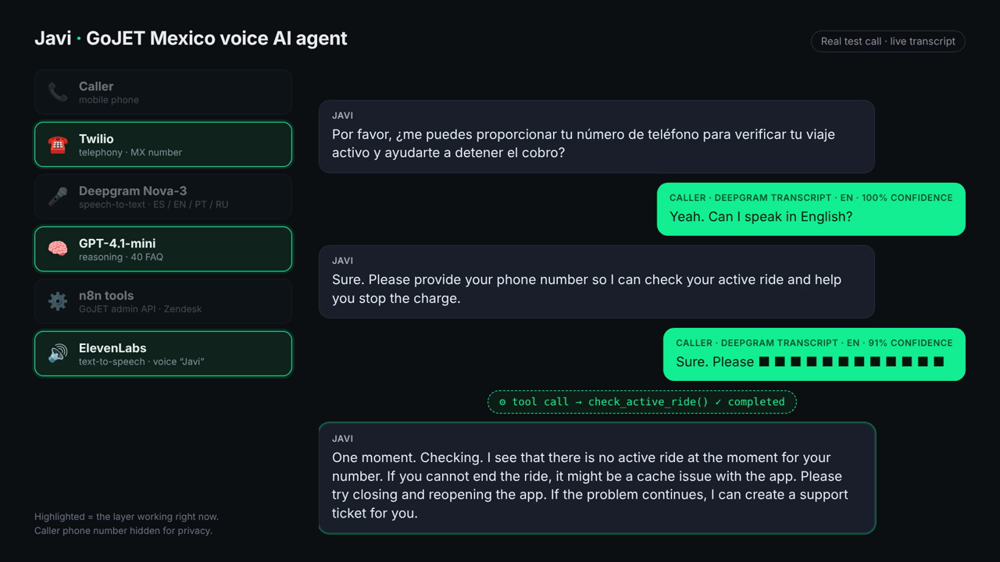
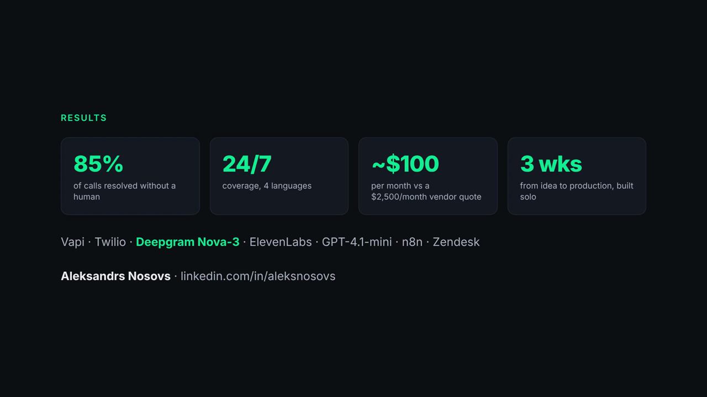
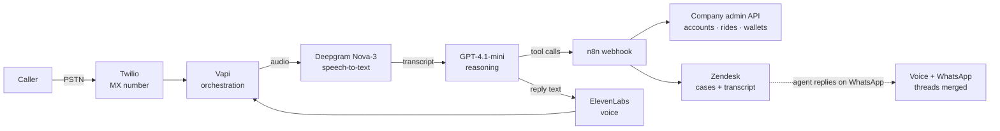

# Voice AI customer support agent: Javi, live at GoJET Mexico

A 24/7 multilingual voice agent that answers a real support phone line, resolves issues during the call through backend tools, and hands off to a human in Zendesk only when it has to.

Built solo in about 3 weeks by [Aleksandrs Nosovs](https://www.linkedin.com/in/aleksnosovs/) for GoJET Mexico (e-scooter and powerbank sharing). In production since May 2026.

**Stack:** Vapi · Twilio · Deepgram Nova-3 · ElevenLabs · OpenAI GPT-4.1-mini · n8n · Zendesk

▶ [Watch the 2-minute demo of a real test call](docs/assets/demo.mp4) (caller number masked) · [Read the full story on LinkedIn](https://www.linkedin.com/pulse/we-had-regulatory-requirement-call-center-built-ai-bot-nosovs-k3nne/)

---

## The problem

To operate in Mexico, the business needed a phone support line. That was a regulatory requirement, not a nice-to-have.

The cheapest call-center quote was **$2,500/month**, and it didn't even cover 24/7. We needed round-the-clock coverage in a market where customers call when something goes wrong mid-ride.

So I treated "we need a call center" as a design constraint instead of a procurement task, and built one with AI.

## Results

| | Vendor call center (quote) | Javi |
|---|---|---|
| Monthly cost | $2,500 | ~$100 |
| Coverage | Limited hours | 24/7 |
| Languages | Spanish | Spanish, English, Portuguese, Russian |
| Calls resolved without a human | n/a | **~85%** |
| Average call | n/a | 2-3 minutes |
| Time to launch | Procurement + onboarding | 3 weeks, one person |

"Resolved" means the issue was actually fixed (ride ended, balance explained, refund status given), not that the call simply ended. The other ~15% become a Zendesk case with the full transcript, so the human agent never starts cold.

The economics hold for low to mid call volumes. Every layer is usage-priced, so this is not a drop-in replacement for a large call center.

## How it works

1. **Twilio** owns the Mexican phone number and passes the call to Vapi.
2. **Deepgram Nova-3** transcribes the caller in real time in multilingual mode. Callers switch languages mid-call, and the agent follows.
3. **GPT-4.1-mini** decides what to say and which tool to call. It runs on a short, strict system prompt plus about 40 FAQ answers.
4. **n8n** receives Vapi's tool calls on one webhook, routes them to the company's admin API or Zendesk, and returns a result the model can read out loud.
5. **ElevenLabs** speaks the reply in a consistent voice ("Javi").
6. When a human is needed, a **Zendesk** case is created with the summary and transcript. If the customer later replies on WhatsApp, the voice and WhatsApp threads merge automatically.

### Tools the agent can call during a call

| Tool | What it does |
|---|---|
| `lookup_account` | Finds the account by the caller's number first; asks for the number only if that fails |
| `check_active_ride` | Checks whether the customer has a ride that is still running |
| `end_ride` | Ends a stuck ride so billing stops |
| `check_balance` | Reads wallet balances and bonuses across countries |
| `create_ticket` | Opens a Zendesk case for a human, with summary and language |

## What was actually hard

The model was the easy part. These took most of the three weeks, and most of the six months since:

- **Resolving, not routing.** A voice bot that only opens tickets is an expensive IVR. Connecting it to the real admin API so it can end a ride or read a balance on the call is what moved the deflection number.
- **Language switching.** "We support Spanish and English" is easy. Following a caller who starts in Portuguese, asks to switch to English, and finishes in Spanish is not. See it in the demo.
- **Handoff rules.** When to give up and bring in a human, so the bot neither traps people nor escalates everything.
- **Silence.** People put the phone down to look at the app. The agent has to wait, nudge once, and not hang up too early.
- **Clean tickets.** Every call that needs a human must leave a case a human can act on without calling back.
- **Phone numbers dictated digit by digit.** This was the #1 failure point after launch. The fix: look up the account by caller ID first, and only ask the caller to dictate the number if that fails.

More detail: [docs/lessons-learned.md](docs/lessons-learned.md) · Cost model: [docs/cost-model.md](docs/cost-model.md)

## Use the template

`template/` is a clean, generic version of the pattern for a fictional micromobility company ("RideCo"). It contains no GoJET code, keys or data.

| Path | What it is |
|---|---|
| [`template/vapi/assistant.example.json`](template/vapi/assistant.example.json) | Vapi assistant: Deepgram Nova-3 multilingual, GPT-4.1-mini, ElevenLabs, tools wired to n8n |
| [`template/prompts/system-prompt.md`](template/prompts/system-prompt.md) | System prompt with tool-use, language, silence and escalation rules |
| [`template/tools/`](template/tools/) | JSON schemas for the five tools |
| [`template/n8n/vapi-tools-webhook.json`](template/n8n/vapi-tools-webhook.json) | Importable n8n workflow: one webhook, routing by tool name, admin API + Zendesk, Vapi-formatted response |
| [`examples/`](examples/) | A real-shaped Vapi `tool-calls` request, the expected response, and a curl test |

Setup in short:

1. Copy `.env.example` and set your backend and Zendesk values in n8n's environment.
2. Import `template/n8n/vapi-tools-webhook.json` into n8n, attach a Zendesk credential (HTTP Basic Auth, `email/token` + API token), and activate it.
3. Create a Vapi assistant from `template/vapi/assistant.example.json`, replace `YOUR_N8N_HOST` and the voice ID, paste the system prompt.
4. Buy or port a number in Twilio, import it into Vapi, and assign the assistant.
5. Test the webhook with `examples/test-webhook.sh`, then call the number.

## About me

I'm Aleksandrs (Alex) Nosovs, a customer operations leader who builds the AI systems himself: voice and chat bots, n8n automations, Zendesk architecture, LLM-based ticket handling. Background in travel (Aviasales, App in the Air), AI apps (Prisma Labs) and mobility (JET / GoJET).

Open to AI automation, CX automation and conversational AI roles in travel, live events and mobility. Reach me on [LinkedIn](https://www.linkedin.com/in/aleksnosovs/).

## License

MIT for the template and docs in this repository. Product names belong to their owners.
